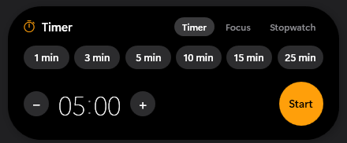
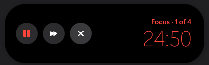
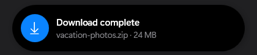
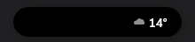
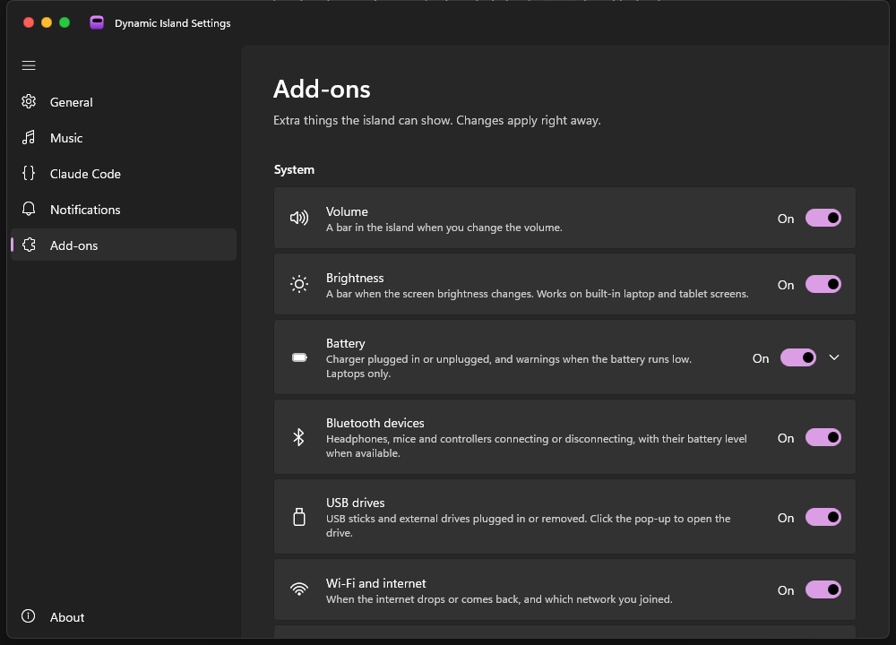

# Dynamic Island for Windows

[](https://github.com/aangeraakt/DI4W/actions/workflows/build.yml)
[](https://github.com/aangeraakt/DI4W/releases/latest)
[](LICENSE)

The iPhone Dynamic Island, rebuilt for the Windows desktop.

A small black pill sits at the top-center of your screen. It changes shape to show what is going on: music playing, Claude working, a timer counting down, a download finishing, or a new message.

<p align="center">
  
  &nbsp;
  
</p>
<p align="center">
  
  &nbsp;
  
</p>
<p align="center">
  
  &nbsp;
  
</p>

## Features

| | In the pill | Click to expand |
|---|---|---|
| 🎵 **Spotify** | Album art and live audio bars, tinted to match the album art | Art, title and artist, a seekable progress bar, ⏮ ⏯ ⏭ |
| ✳️ **Claude Code** | Spinning Claude logo and elapsed time while Claude works | Every running session with its project and time |
| ⏱️ **Timer** | Orange timer icon and countdown | Pause/resume, cancel and a large countdown |
| 🍅 **Focus timer** | Red progress ring and countdown; work and break periods run back to back | Pause, skip to the next period, stop |
| ⏲️ **Stopwatch** | Counts up | Pause/resume, stop, tenths of a second |
| 💬 **Chat apps** | Discord, WhatsApp, Telegram, Teams, Slack, Signal and Outlook messages pop out; calls show as a call card | Click to jump to the app |

### Add-ons

Each one has its own switch under **Settings → Add-ons** (calls and chat apps under **Notifications**). Search the list, show only the ones that are on or off, and press **Preview** to see a sample pop-up in the island. Open an add-on to set **quiet times**: hours when its pop-ups stay away (for example clipboard pop-ups from 22:00 to 08:00), or apps that silence it while they're in front (a game, OBS, PowerPoint).

| | What it shows |
|---|---|
| 🔊 **Volume** / ☀️ **Brightness** | An iOS-style bar when you change them (brightness: built-in laptop screens) |
| 🔋 **Battery** | Charger plugged in or unplugged, and warnings at 20% and 10% (adjustable) |
| 🎧 **Bluetooth** | "AirPods · Connected · 80% battery" when a paired device connects or disconnects |
| 📱 **iPhone** | Your iPhone's notifications and calls (as the call card) through Windows' Phone Link, and its battery level with a low-battery warning. Link the iPhone in Phone Link first; nothing to install on the iPhone |
| 💾 **USB drives** | A drive plugged in or removed, with its name and size; click to open it |
| 📶 **Wi-Fi and internet** | No internet, back online, or which network you joined |
| 🟠 **Microphone and camera** | An orange or green dot next to the island while an app uses them |
| ⇪ **Caps Lock / Num Lock** | "Caps Lock on" / "off" |
| 🔥 **Heavy load** | CPU or memory nearly full for a while, or an NVIDIA GPU running hot, with the process using the most |
| 📅 **Calendar** | "Meeting in 5 min" with a **Join** button for Teams, Zoom, Google Meet and Webex. Add your calendar's .ics link in the settings |
| 📋 **Clipboard** | A short preview of what you copied (never passwords from password managers) |
| 📸 **Screenshots** | A thumbnail of a new screenshot; click to open it |
| ⬇️ **Downloads** | Size and speed in the pill while a browser downloads; "Download complete" after |
| 📁 **File copies** | Progress of File Explorer copies and moves |
| 🌙 **Do Not Disturb** | Follows Windows' Do Not Disturb: only alarms and timers pop up, and a moon shows in the island |
| 🔄 **Windows Update** | "Restart to finish installing", with a one-minute restart you can still cancel |
| ⛅ **Weather** | The temperature in the empty island and "Rain in about 15 min". Set your city in the settings |
| 🎮 **Game mode** | Off by default. Keeps the island over fullscreen games with GPU load and temperature (no frame rate: Windows only shares it with programs running as administrator) |

It also includes:

- **iOS-style animation.** The pill springs between sizes with a small bounce, and content fades in with a blur.
- **Two at once.** When two things are active, the second shows as a small circle next to the pill, as on the iPhone. Click it to swap them.
- **Alerts.** "Claude is done", "Claude needs you", "Timer done", messages and add-on pop-ups open and close again by themselves. They stay open while your mouse is over them.
- **Stays out of the way.** It never takes keyboard focus, you can click through everything around the pill, and it hides while a fullscreen game or video is playing.
- **Lightweight.** Native C# and WPF, with a separate WinUI 3 settings app. Spotify works without a Spotify account or API key. With Windows' battery saver on, it redraws less often and skips blur and shadow effects.
- **Any display.** Pick the display it sits on, or let it follow your mouse. It stays below a taskbar that's at the top of the screen.
- **English, Dutch, German and French.** It follows your Windows language, or you can pick one under **Settings → General**.
- **Accessible.** Screen readers announce new pop-ups and can read what the island shows. **Ctrl+Alt+O** opens it without a mouse.
- **Dark or light.** A black pill like the iPhone, a light one, or one that follows Windows' light or dark mode. Size, distance from the top and theme have a live preview under **Settings → General**.
- **Welcome tour.** After a fresh install the settings app explains the island and its shortcuts and lets you pick add-ons. See it again under **Settings → About**.
- **Recent alerts.** Missed something? Click the empty island and choose **Recent**, or pick **Recent alerts…** from the tray menu. It also lists pop-ups that Do Not Disturb or quiet times held back.
- **Your order.** When several things run at once, you decide which one gets the pill: drag them into order under **Settings → General → Order**.
- **Music controls on hover.** Point at the music in the pill for play/pause and next, without opening the player.
- **Backup.** Export all settings to a file and import them on another PC (**Settings → About**).
- **Crash reports you control.** If the island ever crashes, it offers to open a GitHub issue with the details filled in. You see everything first; nothing is sent by itself.

## Install

1. Install the [.NET 8 Desktop Runtime](https://dotnet.microsoft.com/download/dotnet/8.0) (x64, or Arm64 for Snapdragon PCs) if you don't have it. The installer tells you if it's missing.
2. Download **DI4W-v…-win-x64.msi** (or **-win-arm64.msi** for Snapdragon and other Arm PCs) from the [latest release](https://github.com/aangeraakt/DI4W/releases/latest) and run it. Or install it with `winget install aangeraakt.DynamicIsland`.

The installer needs no administrator rights. It installs to `%LocalAppData%\Programs\Dynamic Island`, adds Start Menu shortcuts and an entry in **Settings → Apps → Installed apps**, and starts the island with Windows. You can turn that off in the settings app. Prefer no installer? The release also has a `.zip` you can unzip anywhere.

Requires Windows 10 (version 2004 or later) or Windows 11, x64 or Arm64.

<p align="center"></p>

## Building from source

You need the [.NET 8 SDK](https://dotnet.microsoft.com/download/dotnet/8.0).

```bash
git clone https://github.com/aangeraakt/DI4W.git
cd DI4W
dotnet run --project src/DynamicIsland -c Release
```

The island appears at the top of your screen, with a purple icon in the system tray.

To get a standalone `.exe` instead:

```bash
dotnet publish src/DynamicIsland -c Release -o publish
```

This publishes the island and the settings app (`publish\Settings\`) in one go. Then run `publish\DynamicIsland.exe`. To start it automatically, turn on **Start with Windows** in the settings app.

## How to use it

| Action | What happens |
|---|---|
| **Click the empty island** | Opens the timer picker. Choose a preset, or scroll over the minutes/seconds, then press **Start**. The **Recent** tab lists the latest alerts. |
| **Point at the music** | Play/pause and next appear in the pill. |
| **Click an activity** | Expands it (music player, timer controls, Claude sessions). |
| **Move the mouse away** | Collapses it again. |
| **Click the small circle** | Swaps the second activity into the main pill. |
| **Click an alert** | Opens the app it came from and closes the alert. |
| **Right-click the island or tray icon** | **Open settings**, hide or show the island, timers, focus and stopwatch, updates and Quit. |
| **Click the tray icon** | Brings a hidden island back. While it's hidden the tray icon is faded with an orange pause badge. |
| **Double-click the tray icon** | Opens the settings app. |
| **Press Ctrl+Alt+I** | Hides the island, or brings it back. It stays hidden after a restart until you show it again. |
| **Press Ctrl+Alt+O** | Opens what the island shows (or the timer picker), and closes it again. Both shortcuts can be changed under **Settings → General**. |

## Setting up the integrations

### 🎵 Spotify

No setup is needed. Open Spotify and play something. The island reads Windows' built-in media controls, the same ones the volume pop-up uses.

To show other players too (browser, Apple Music and so on), turn on **Show any media player** under **Music** in the settings app.

### ✳️ Claude Code

Run this once to connect Claude Code to the island:

```bash
powershell -ExecutionPolicy Bypass -File tools/install-claude-hooks.ps1
```

This adds four [hooks](https://docs.claude.com/en/docs/claude-code/hooks) to `~/.claude/settings.json`. Your other settings are kept, and a `.bak` backup is made first.

| Claude Code event | Island shows |
|---|---|
| You send a prompt | "Claude is working" with a timer |
| Claude finishes | **Claude is done** with the project name and how long it took |
| Claude needs permission or input | **Claude needs you** (amber, stays until you hover it) |
| Session closes | The working activity disappears |

The hooks only apply to Claude Code sessions started *after* you install them. To remove them again:

```bash
powershell -ExecutionPolicy Bypass -File tools/install-claude-hooks.ps1 -Uninstall
```

<details>
<summary>Test it without Claude</summary>

```powershell
Invoke-RestMethod -Method Post http://127.0.0.1:47823/claude/stop -Body '{"cwd":"C:\\my-project"}'
```
</details>

### 💬 Discord

1. Make sure desktop notifications are **on** in Discord (**User Settings → Notifications**).
2. The first time the island starts, Windows may ask whether it can read your notifications. Click **Allow**.
3. *(Optional)* To get only the island pop-up instead of both it and the normal Windows pop-up, go to **Windows Settings → System → Notifications → Discord** and turn off **Show notification banners**. The island keeps working.

You can add other apps, such as WhatsApp or Outlook, under **Notifications** in the settings app.

## Settings

Choose **Open settings** from the tray or right-click menu. It is a separate WinUI 3 app in the Windows 11 Settings style, with macOS-style red, yellow and green window buttons in the top-left corner. Changes save immediately and the island applies them right away. Turning music or Claude Code on or off, changing the port, the language or the theme restarts the island by itself.

Each add-on shows its state under its switch, for example "Set your city below" for the weather, or "Next: Stand-up at 9:00" for the calendar. Orange means something needs your attention.

Everything is stored in `%AppData%\DynamicIsland\settings.json`. You can also edit that file by hand; the island picks up the changes. If the file ever can't be read (a typo while editing), the island keeps it as `settings.json.bad` and starts with default settings, so nothing is lost.

| Setting | Default | Description |
|---|---|---|
| `TopOffset` | `8` | Distance from the top of the screen |
| `Scale` | `1.0` | Overall size (also under **Size** in the menu) |
| `Theme` | `""` | `""` dark, `"Light"`, or `"System"` to follow Windows |
| `ActivityOrder` | `[]` | Which activity gets the pill first, e.g. `["Media","Timer"]`; empty is the built-in order |
| `Addons.Quiet` | `{}` | Quiet times per add-on, e.g. `{"Clipboard":{"HoursOn":true,"From":"22:00","To":"08:00","Apps":["obs64"]}}` |
| `HideInFullscreen` | `true` | Hide while fullscreen games or videos run |
| `MediaEnabled` | `true` | Show the music activity |
| `MediaAnyPlayer` | `false` | Show players other than Spotify |
| `MediaHideAfterPauseSeconds` | `10` | How long the music activity stays after you pause |
| `ClaudeEnabled` | `true` | Listen for Claude Code hooks |
| `ClaudePort` | `47823` | Local port for the hooks (also set `DYNAMIC_ISLAND_PORT` for the hook script if you change it) |
| `NotificationsEnabled` | `true` | Show notification pop-outs |
| `NotificationApps` | `["Discord"]` | Apps whose notifications pop out of the island |
| `Sounds` | `true` | Chimes for alerts and the timer alarm |

Logs are written to `%AppData%\DynamicIsland\logs`.

## Updates

The app updates itself from this repository's [GitHub releases](https://github.com/aangeraakt/DI4W/releases).

- A little after it starts, and every 6 hours after that, the island checks for a newer release. When there is one, an **Update available** alert pops out of the island. You can turn this off under **Settings → About → Check automatically**.
- Click the alert, or go to **Settings → About → Check now**, to see what's new. **Download and install** downloads the release and checks its size and SHA-256 against what GitHub reports.
- **Installed with the installer:** the new installer runs and upgrades in place, so **Installed apps** stays correct.
- **Unzipped copy:** the current files are backed up, the new ones are copied in, and if anything goes wrong the backup is put back, so you never end up with a half-updated mix.
- Either way the island starts again afterwards, as you (never as administrator). Your settings are kept, since they live in `%AppData%`. The install log is `%AppData%\DynamicIsland\logs\update.log`.
- Updating only works in the published app (`DynamicIsland.exe` with the settings app in `Settings\`), not when running from source.

### Publishing a release

```bash
powershell -ExecutionPolicy Bypass -File tools/publish-release.ps1 -Version 1.1.0
```

This sets the version in both projects and, for x64 and Arm64, builds the app, zips it as `DI4W-v1.1.0-win-<arch>.zip` and builds the installer `DI4W-v1.1.0-win-<arch>.msi` from the same files. It then commits and pushes the version change and creates the `v1.1.0` release with all four attached. Add `-NotesFile notes.md` to use your own release notes (otherwise GitHub generates them), `-Draft` to review the release before publishing it, or `-NoArm64` to build x64 only. You need the [GitHub CLI](https://cli.github.com/), logged in with `gh auth login`.

It also writes the winget manifests (`artifacts/release/winget`) and, once the package is listed in winget, submits the new version there by itself (`-NoWinget` skips that). The very first submission, or a retry, is done by hand:

```bash
powershell -ExecutionPolicy Bypass -File tools/winget-submit.ps1 -Version 1.1.0
```

This opens a pull request to [microsoft/winget-pkgs](https://github.com/microsoft/winget-pkgs) from your account; after Microsoft's checks and a review, `winget install aangeraakt.DynamicIsland` works.

The updater only picks up releases whose tag is a version (`v1.2.3`) and that have a `*-win-x64.zip`/`.msi` asset (`*-win-arm64` for the Arm64 build; each build stays on its own architecture). Drafts and pre-releases are ignored.

### Code signing

Unsigned downloads make Windows SmartScreen show "Windows protected your PC" to new users. `publish-release.ps1` signs the apps and installers when it's given a certificate; without one it builds unsigned and says so. Two ways to get one:

- **[SignPath Foundation](https://signpath.org/)**: free code signing for open-source projects. Apply with the repository; once accepted, sign through their service.
- **[Azure Trusted Signing](https://learn.microsoft.com/azure/trusted-signing/)**: a few euros a month, for individuals and companies Microsoft can verify. Install the [Trusted Signing client tools](https://learn.microsoft.com/azure/trusted-signing/how-to-signing-integrations), then:

```powershell
$env:DI4W_TRUSTED_SIGNING_METADATA = "C:\signing\metadata.json"   # endpoint, account and certificate profile
$env:DI4W_TRUSTED_SIGNING_DLIB = "C:\signing\Azure.CodeSigning.Dlib.dll"
```

With a regular code-signing certificate in your certificate store, set `DI4W_SIGN_THUMBPRINT` (or pass `-CertThumbprint`) instead. Signing uses `signtool.exe` from the Windows SDK.

### Tests

```bash
dotnet test tests/DynamicIsland.Tests
```

The tests cover the logic that decides things: shortcut parsing, chat-app and call detection, release and calendar parsing (including recurring meetings), the alert queue, and how settings are saved and recovered. GitHub Actions runs them, builds both apps and the installer on every push, and keeps the result as a downloadable `DI4W-build` artifact for 14 days.

## Island API

Scripts and apps on your PC can show their own pop-ups and progress in the island. The API listens on `http://127.0.0.1:47823` (the Claude Code port), only for programs on this PC. Requests from web pages are refused. You can turn it off under **Settings → Add-ons → Island API**.

**A pop-up**

```bash
curl -X POST http://127.0.0.1:47823/alert -H "Content-Type: application/json" -d "{\"title\":\"Backup done\",\"message\":\"312 files\",\"icon\":\"success\",\"color\":\"green\"}"
```

| Field | | |
|---|---|---|
| `title` | required | Up to 120 characters |
| `message` | optional | Second line, up to 300 characters |
| `icon` | optional | `info`, `success`, `warning`, `error`, `download`, `upload`, `music`, `mail`, `timer`, `bell`, `code`, `home`, `star`, `heart`, `game`, `sync` |
| `color` | optional | `blue`, `green`, `orange`, `red`, `purple`, `teal`, `yellow`, `indigo`, `gray`, or `#RRGGBB` |
| `seconds` | optional | How long it stays, 1–60 (default 5) |
| `sticky` | optional | `true` keeps it open until the mouse has been over it |
| `url` | optional | An `http`/`https` link opened when the pop-up is clicked |
| `buttons` | optional | Up to two buttons: `[{"id":"log","label":"Open log","url":"https://…"},{"id":"retry","label":"Retry"}]`. The last one is the main one; `url` is optional |

The answer is `{"ok":true,"id":"…"}`. To find out what happened to the pop-up, ask `GET /alert/<id>`: `state` is `open`, `clicked` (with `button`, the clicked button's `id`, or `null` for the pop-up itself) or `dismissed`. Results are kept for 15 minutes.

**Progress in the pill**

```bash
curl -X POST http://127.0.0.1:47823/progress -H "Content-Type: application/json" -d "{\"id\":\"backup\",\"title\":\"Backing up\",\"value\":0.4,\"detail\":\"120 of 312 files\"}"
curl -X POST http://127.0.0.1:47823/progress -H "Content-Type: application/json" -d "{\"id\":\"backup\",\"done\":true,\"message\":\"Backup done\"}"
```

`value` is 0 to 1 (leave it out for "busy" without a percentage). Up to 5 at once; one that isn't updated for 15 minutes disappears by itself. At most 30 pop-ups a minute.

**PowerShell helper** (in the app's `tools` folder):

```powershell
island.ps1 -Title "Backup done" -Icon success -Color green
island.ps1 -Title "Build failed" -Icon error -Color red -Button "log=Open log" -Button "retry=Retry" -Wait   # prints log, retry, alert or dismissed
island.ps1 -Progress backup -Title "Backing up" -Value 0.4 -Detail "120 of 312 files"
island.ps1 -Progress backup -Done -Title "Backup done"
```

## Troubleshooting

- **Nothing happens with Spotify.** Make sure Spotify is the desktop app, not the web player, or turn on **Show any media player**.
- **The audio bars don't move.** The bars react to what your speakers play. If no audio device is available, they fall back to a simple animation.
- **No Claude alerts.** Start a *new* Claude Code session after installing the hooks, and check that the island is running.
- **No Discord pop-ups.** Check that notification access is allowed under **Windows Settings → Privacy & security → Notifications**, and that Discord's own notifications are on.
- **Something else.** Use **Settings → About → Report a problem**. It fills in a GitHub issue with your version and the latest log lines, which you can check and edit before anything is sent.

## Project structure

```
src/DynamicIsland/
├─ IslandWindow.xaml(.cs)      the pill: window, shapes, spring animation, input
├─ Animation/Spring.cs         damped spring used for all shape changes
├─ Core/                       Activity base class, ActivityManager (priorities, alerts), logging
├─ Activities/
│  ├─ Media/                   Windows media session + loopback audio bars
│  ├─ Claude/                  local hook server + Claude activity/alerts
│  ├─ Notifications/           Windows notification listener (Discord)
│  ├─ Focus/ Stopwatches/      Pomodoro focus timer and stopwatch
│  └─ Timer/                   timer activity + picker (Timer / Focus / Stopwatch)
├─ Addons/                     optional features with a switch each: SystemAddons/, Productivity/, Alerts/, Info/
├─ Settings/                   settings.json, status.json (add-on states), Start with Windows
├─ Updates/UpdateChecker.cs    looks for newer GitHub releases (shared with the settings app)
└─ UI/Ui.cs                    shared colors, fonts, icons and controls
src/DynamicIsland.Settings/     WinUI 3 settings app (shares Settings/ and Updates/ with the island)
└─ Updater.cs                  downloads, verifies and installs updates (with rollback)
installer/                      WiX installer (.msi): per-user, Start Menu, Installed apps, autostart
tests/DynamicIsland.Tests/      xUnit tests
.github/workflows/build.yml     tests and builds on every push
tools/
├─ claude-hook.ps1             called by Claude Code hooks, forwards events to the island
├─ install-claude-hooks.ps1    adds/removes the hooks in ~/.claude/settings.json
├─ island.ps1                  shows pop-ups and progress through the Island API
├─ publish-release.ps1         builds the app and installer and publishes a GitHub release
├─ winget-manifest.ps1         writes the winget manifests for a release
└─ winget-submit.ps1           submits a release to winget (pull request to microsoft/winget-pkgs)
```

### Adding your own activity

Subclass `Core/Activity`. Provide `Leading`, `Trailing`, `Bubble` and `Expanded` views and a `Priority`, and set `IsActive`. Then register it in `App.xaml.cs` with `_manager.Register(...)`. For one-off pop-ups, call `_manager.ShowAlert(new IslandAlert { ... })`.

## License

[MIT](LICENSE)
