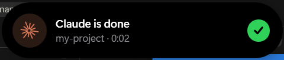
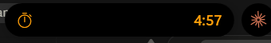

# Dynamic Island for Windows

The iPhone Dynamic Island, rebuilt for the Windows desktop.

A small black pill sits at the top-center of your screen. It changes shape to show what is going on: music playing, Claude working, a timer counting down, or a new Discord message.

<p align="center">
  
  &nbsp;&nbsp;
  
</p>

## Features

| | In the pill | Click to expand |
|---|---|---|
| 🎵 **Spotify** | Album art and live audio bars, tinted to match the album art | Art, title and artist, a seekable progress bar, ⏮ ⏯ ⏭ |
| ✳️ **Claude Code** | Spinning Claude logo and elapsed time while Claude works | Every running session with its project and time |
| ⏱️ **Timer** | Orange timer icon and countdown | Pause/resume, cancel and a large countdown |
| 🍅 **Focus timer** | Red progress ring and countdown; work and break periods run back to back | Pause, skip to the next period, stop |
| ⏲️ **Stopwatch** | Counts up | Pause/resume, stop, tenths of a second |
| 💬 **Chat apps** | Discord, WhatsApp, Telegram, Teams, Slack, Signal and Outlook messages pop out; calls show as a call card | Click to jump to the app |

### Add-ons

Each one has its own switch under **Settings → Add-ons** (calls and chat apps under **Notifications**).

| | What it shows |
|---|---|
| 🔊 **Volume** / ☀️ **Brightness** | An iOS-style bar when you change them (brightness: built-in laptop screens) |
| 🔋 **Battery** | Charger plugged in or unplugged, and warnings at 20% and 10% (adjustable) |
| 🎧 **Bluetooth** | "AirPods · Connected · 80% battery" when a paired device connects or disconnects |
| 💾 **USB drives** | A drive plugged in or removed, with its name and size; click to open it |
| 📶 **Wi-Fi and internet** | No internet, back online, or which network you joined |
| 🟠 **Microphone and camera** | An orange or green dot next to the island while an app uses them |
| ⇪ **Caps Lock / Num Lock** | "Caps Lock on" / "off" |
| 🔥 **Heavy load** | CPU or memory nearly full for a while, or an NVIDIA GPU running hot, with the process using the most |
| 📅 **Calendar** | "Meeting in 5 min" with a **Join** button for Teams, Zoom, Google Meet and Webex. Add your calendar's .ics link in the settings |
| 📋 **Clipboard** | A short preview of what you copied (never passwords from password managers) |
| 📸 **Screenshots** | A thumbnail of a new screenshot; click to open it |
| ⬇️ **Downloads** | Size and speed in the pill while a browser downloads; "Download complete" after |
| 📁 **File copies** | Progress of File Explorer copies and moves |
| 🌙 **Do Not Disturb** | Follows Windows' Do Not Disturb: only alarms and timers pop up, and a moon shows in the island |
| 🔄 **Windows Update** | "Restart to finish installing", with a one-minute restart you can still cancel |
| ⛅ **Weather** | The temperature in the empty island and "Rain in about 15 min". Set your city in the settings |
| 🎮 **Game mode** | Off by default. Keeps the island over fullscreen games with GPU load and temperature (no frame rate: Windows only shares it with programs running as administrator) |

It also includes:

- **iOS-style animation.** The pill springs between sizes with a small bounce, and content fades in with a blur.
- **Two at once.** When two things are active, the second shows as a small circle next to the pill, as on the iPhone. Click it to swap them.
- **Alerts.** "Claude is done", "Claude needs you", "Timer done", messages and add-on pop-ups open and close again by themselves. They stay open while your mouse is over them.
- **Stays out of the way.** It never takes keyboard focus, you can click through everything around the pill, and it hides while a fullscreen game or video is playing.
- **Lightweight.** Native C# and WPF, with a separate WinUI 3 settings app. Spotify works without a Spotify account or API key.

## Requirements

- Windows 10 (version 2004 or later) or Windows 11
- [.NET 8 SDK](https://dotnet.microsoft.com/download/dotnet/8.0)

## Getting started

```bash
git clone https://github.com/aangeraakt/DI4W.git
cd DI4W
dotnet run --project src/DynamicIsland -c Release
```

The island appears at the top of your screen, with a purple icon in the system tray.

To get a standalone `.exe` instead:

```bash
dotnet publish src/DynamicIsland -c Release -o publish
```

This publishes the island and the settings app (`publish\Settings\`) in one go. Then run `publish\DynamicIsland.exe`. To start it automatically, turn on **Start with Windows** in the settings app.

## How to use it

| Action | What happens |
|---|---|
| **Click the empty island** | Opens the timer picker. Choose a preset, or scroll over the minutes/seconds, then press **Start**. |
| **Click an activity** | Expands it (music player, timer controls, Claude sessions). |
| **Move the mouse away** | Collapses it again. |
| **Click the small circle** | Swaps the second activity into the main pill. |
| **Click an alert** | Opens the app it came from and closes the alert. |
| **Right-click the island or tray icon** | Quick timers, Pause, **Settings…** and Quit. |
| **Double-click the tray icon** | Opens the settings app. |
| **Press Ctrl+Alt+I** | Hides the island, or brings it back. You can change the shortcut under **Settings → General**. |

## Setting up the integrations

### 🎵 Spotify

No setup is needed. Open Spotify and play something. The island reads Windows' built-in media controls, the same ones the volume pop-up uses.

To show other players too (browser, Apple Music and so on), turn on **Show any media player** under **Music** in the settings app.

### ✳️ Claude Code

Run this once to connect Claude Code to the island:

```bash
powershell -ExecutionPolicy Bypass -File tools/install-claude-hooks.ps1
```

This adds four [hooks](https://docs.claude.com/en/docs/claude-code/hooks) to `~/.claude/settings.json`. Your other settings are kept, and a `.bak` backup is made first.

| Claude Code event | Island shows |
|---|---|
| You send a prompt | "Claude is working" with a timer |
| Claude finishes | **Claude is done** with the project name and how long it took |
| Claude needs permission or input | **Claude needs you** (amber, stays until you hover it) |
| Session closes | The working activity disappears |

The hooks only apply to Claude Code sessions started *after* you install them. To remove them again:

```bash
powershell -ExecutionPolicy Bypass -File tools/install-claude-hooks.ps1 -Uninstall
```

<details>
<summary>Test it without Claude</summary>

```powershell
Invoke-RestMethod -Method Post http://127.0.0.1:47823/claude/stop -Body '{"cwd":"C:\\my-project"}'
```
</details>

### 💬 Discord

1. Make sure desktop notifications are **on** in Discord (**User Settings → Notifications**).
2. The first time the island starts, Windows may ask whether it can read your notifications. Click **Allow**.
3. *(Optional)* To get only the island pop-up instead of both it and the normal Windows pop-up, go to **Windows Settings → System → Notifications → Discord** and turn off **Show notification banners**. The island keeps working.

You can add other apps, such as WhatsApp or Outlook, under **Notifications** in the settings app.

## Settings

Open **Settings…** from the tray or right-click menu. It is a separate WinUI 3 app in the Windows 11 Settings style, with macOS-style red, yellow and green window buttons in the top-left corner. Changes save immediately and the island applies them right away. Turning music or Claude Code on or off, or changing the port, restarts the island by itself.

Everything is stored in `%AppData%\DynamicIsland\settings.json`. You can also edit that file by hand; the island picks up the changes.

| Setting | Default | Description |
|---|---|---|
| `TopOffset` | `8` | Distance from the top of the screen |
| `Scale` | `1.0` | Overall size (also under **Size** in the menu) |
| `HideInFullscreen` | `true` | Hide while fullscreen games or videos run |
| `MediaEnabled` | `true` | Show the music activity |
| `MediaAnyPlayer` | `false` | Show players other than Spotify |
| `MediaHideAfterPauseSeconds` | `10` | How long the music activity stays after you pause |
| `ClaudeEnabled` | `true` | Listen for Claude Code hooks |
| `ClaudePort` | `47823` | Local port for the hooks (also set `DYNAMIC_ISLAND_PORT` for the hook script if you change it) |
| `NotificationsEnabled` | `true` | Show notification pop-outs |
| `NotificationApps` | `["Discord"]` | Apps whose notifications pop out of the island |
| `Sounds` | `true` | Chimes for alerts and the timer alarm |

Logs are written to `%AppData%\DynamicIsland\logs`.

## Updates

The app updates itself from this repository's [GitHub releases](https://github.com/aangeraakt/DI4W/releases).

- A little after it starts, and every 6 hours after that, the island checks for a newer release. When there is one, an **Update available** alert pops out of the island. You can turn this off under **Settings → About → Check automatically**.
- Click the alert, or go to **Settings → About → Check now**, to see what's new. **Download and install** downloads the release and checks its size and SHA-256 against what GitHub reports. It then closes both apps, replaces the files and starts the island again on the new version.
- Your settings are kept, since they live in `%AppData%`, not in the app folder. The install log is `%AppData%\DynamicIsland\logs\update.log`.
- Updating only works in the published app (`DynamicIsland.exe` with the settings app in `Settings\`), not when running from source.

### Publishing a release

```bash
powershell -ExecutionPolicy Bypass -File tools/publish-release.ps1 -Version 1.1.0
```

This sets the version in both projects, builds and zips the app as `DI4W-v1.1.0-win-x64.zip`, commits and pushes the version change, and creates the `v1.1.0` release with the zip attached. Add `-NotesFile notes.md` to use your own release notes (otherwise GitHub generates them), or `-Draft` to review the release before publishing it. You need the [GitHub CLI](https://cli.github.com/), logged in with `gh auth login`.

The updater only picks up releases whose tag is a version (`v1.2.3`) and that have a `*-win-x64.zip` asset. Drafts and pre-releases are ignored.

## Troubleshooting

- **Nothing happens with Spotify.** Make sure Spotify is the desktop app, not the web player, or turn on **Show any media player**.
- **The audio bars don't move.** The bars react to what your speakers play. If no audio device is available, they fall back to a simple animation.
- **No Claude alerts.** Start a *new* Claude Code session after installing the hooks, and check that the island is running.
- **No Discord pop-ups.** Check that notification access is allowed under **Windows Settings → Privacy & security → Notifications**, and that Discord's own notifications are on.
- **Something else.** Look in the log folder (settings app → **About** → **Logs**).

## Project structure

```
src/DynamicIsland/
├─ IslandWindow.xaml(.cs)      the pill: window, shapes, spring animation, input
├─ Animation/Spring.cs         damped spring used for all shape changes
├─ Core/                       Activity base class, ActivityManager (priorities, alerts), logging
├─ Activities/
│  ├─ Media/                   Windows media session + loopback audio bars
│  ├─ Claude/                  local hook server + Claude activity/alerts
│  ├─ Notifications/           Windows notification listener (Discord)
│  ├─ Focus/ Stopwatches/      Pomodoro focus timer and stopwatch
│  └─ Timer/                   timer activity + picker (Timer / Focus / Stopwatch)
├─ Addons/                     optional features with a switch each: SystemAddons/, Productivity/, Alerts/, Info/
├─ Settings/                   settings.json + Start with Windows
├─ Updates/UpdateChecker.cs    looks for newer GitHub releases (shared with the settings app)
└─ UI/Ui.cs                    shared colors, fonts, icons and controls
src/DynamicIsland.Settings/     WinUI 3 settings app (shares Settings/ and Updates/ with the island)
└─ Updater.cs                  downloads, verifies and installs updates
tools/
├─ claude-hook.ps1             called by Claude Code hooks, forwards events to the island
├─ install-claude-hooks.ps1    adds/removes the hooks in ~/.claude/settings.json
└─ publish-release.ps1         builds the app and publishes a GitHub release for the updater
```

### Adding your own activity

Subclass `Core/Activity`. Provide `Leading`, `Trailing`, `Bubble` and `Expanded` views and a `Priority`, and set `IsActive`. Then register it in `App.xaml.cs` with `_manager.Register(...)`. For one-off pop-ups, call `_manager.ShowAlert(new IslandAlert { ... })`.

## License

[MIT](LICENSE)
